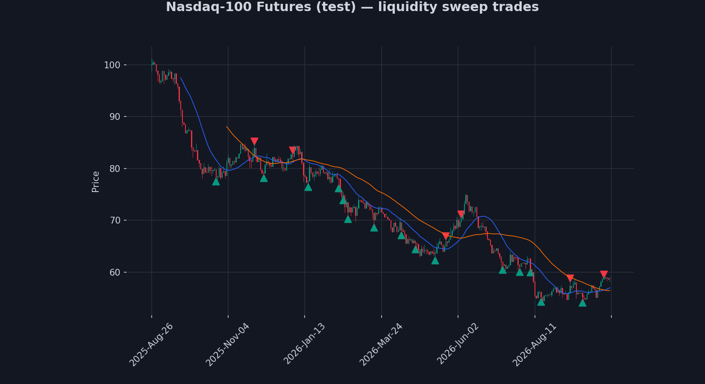

# Nasdaq & Gold Liquidity Sweep Backtester

Personal project to practice Python and test my own trading strategy on
historical data: a "liquidity sweep" pattern I use when trading
Nasdaq-100 and Gold.

## What it does

1. Downloads daily price history for Nasdaq-100 futures (`NQ=F`) and
   Gold futures (`GC=F`) from Yahoo Finance.
2. Calculates a couple of basic trend indicators (moving averages).
3. Looks for liquidity sweeps: days where price breaks below a recent
   low (or above a recent high) and then closes back on the other
   side — often a sign of a reversal rather than a real breakout.
4. Backtests a simple rule: when this happens, enter a trade in the
   reversal direction, risk a fixed amount, aim for 1.5x that risk.
5. Prints the results (number of trades, win rate, total R) and saves
   a chart.

## Why daily candles, not 15-minute?

My actual strategy uses 15-minute candles. Free 15-minute history on
Yahoo Finance only goes back about 60 days, so to test the idea over
several years I used daily candles instead. Same logic, different
timeframe — worth keeping in mind when reading the results.

## Example output



Candlestick chart with a dark theme (using `mplfinance`), styled close
to what I use on TradingView for the actual chart analysis — green/red
candles, two moving averages, and triangle markers for each trade entry.

(This example uses generated sample data, not live Nasdaq/Gold prices —
just to show what the chart looks like without needing to run anything.
Running `demo.py` will fetch real data and produce real charts.)

## How to run it

```bash
pip install -r requirements.txt
python demo.py
```

## Tests

A couple of basic checks on the strategy logic:

```bash
python test_strategy.py
```

## What I learned

- Splitting data by time (not randomly) matters a lot for anything
  related to prediction, otherwise you end up "testing" on information
  that wasn't actually available yet.
- A rule-based signal is much easier to trust and debug than it looks —
  most of the work is being precise about what counts as a "clean"
  reversal versus a normal breakout.

## Next steps

- Try the same logic on real 15-minute data over a shorter window.
- Compare against a simple machine learning model.

## Tech

Python, pandas, yfinance, mplfinance
